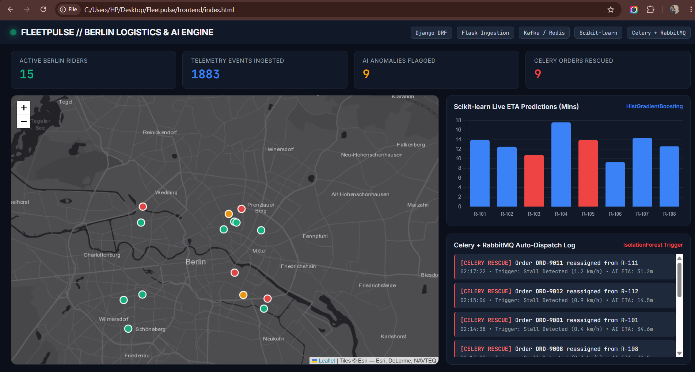

# ⚡ FleetPulse — Real-Time Urban Logistics & AI Anomaly Engine


**FleetPulse** is a distributed, event-driven fleet telemetry and AI dispatch platform modeled after Berlin's quick-commerce and e-bike delivery ecosystems. It ingests high-frequency IoT GPS and battery telemetry streams, predicts live delivery ETAs using **Scikit-learn**, detects stalled or low-battery vehicles via **Isolation Forest**, and triggers asynchronous order rescues using **Celery & RabbitMQ**.



---

## 🏗️ System Architecture

```mermaid
graph LR
    Sim[Berlin IoT Simulator] -->|POST /api/v1/telemetry| Flask[Flask Ingestion Microservice]
    Flask -->|Publish Stream| Kafka[(Apache Kafka / Stream Buffer)]
    Flask -->|Sub-5ms Geo State| Redis[(Redis In-Memory Cache)]
    Flask -->|Real-Time Inference| ML[Scikit-learn AI Engine]
    ML -->|Anomaly Flagged| Celery[Celery + RabbitMQ Worker]
    Celery -->|Haversine Nearest Rider| DB[(MySQL / Django ORM)]
    Django[Django REST Framework] <--> DB
    UI[Dark-Mode Berlin Command UI] -->|1.5s Live Poll| Flask